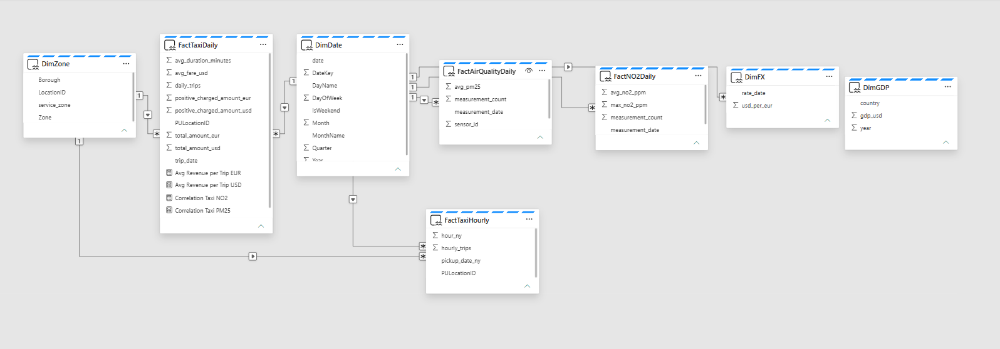
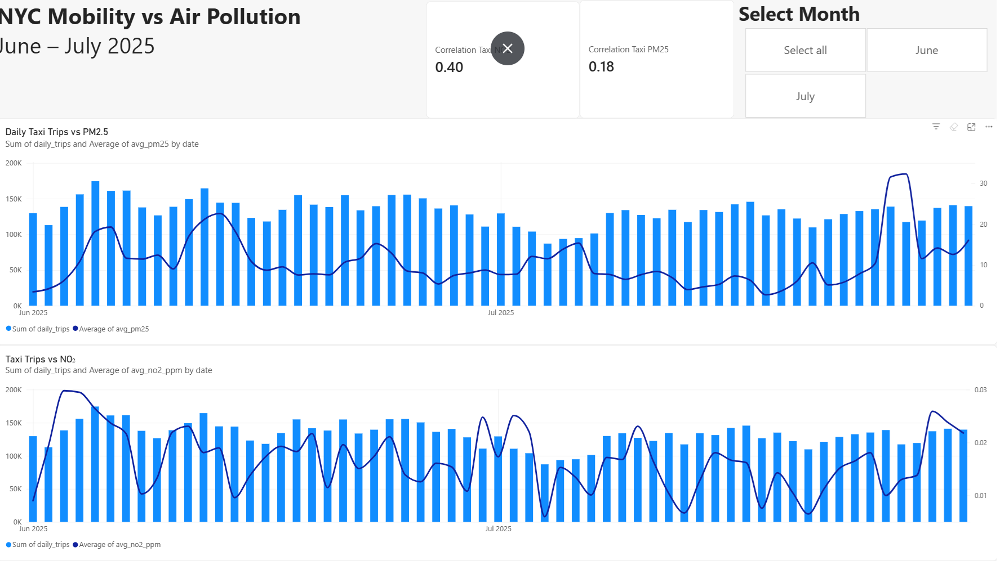
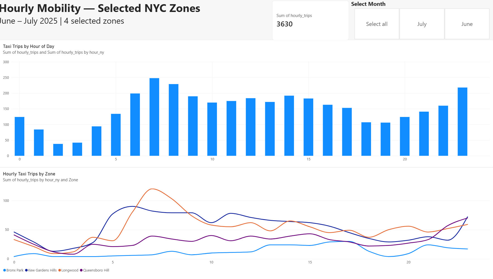

# Microsoft Fabric — Urban Analytics Platform

## Project Overview

An end-to-end Data Engineering platform developed as part of the Itransition Data Engineering internship.

The project integrates urban mobility, air quality, foreign exchange rates, and economic indicators into a unified analytical platform using Microsoft Fabric.

It demonstrates multi-source data ingestion, distributed data processing, Medallion Architecture, data warehousing, ETL orchestration, data quality validation, Slowly Changing Dimensions (SCD Type 2), semantic modeling, and business intelligence.

## Technology Stack

| Category | Technologies |
|---|---|
| Cloud Platform | Microsoft Fabric, OneLake |
| Data Storage | Lakehouse, Data Warehouse, Delta Lake, Parquet |
| Programming | Python, PySpark, SQL, T-SQL |
| Data Integration | Data Factory Pipelines, Dataflow Gen2, REST APIs |
| Data Transformation | Apache Spark, Power Query M |
| Data Modeling | Star Schema, Fact and Dimension Tables, SCD Type 2 |
| Change Detection | SHA-256 Hashing |
| Data Processing | Delta MERGE, Transactional UPDATE and INSERT |
| Business Intelligence | Power BI, DAX, TMDL |
| Version Control | Git, GitHub |
| Development Environment | VS Code, Ubuntu WSL2 |

## Architecture

The platform follows the Bronze, Silver, and Gold Medallion Architecture.

[View the complete architecture diagram](docs/architecture.md)

### Bronze Layer

- Raw data ingestion from external sources.
- Parameterized monthly taxi data ingestion.
- Historical source data preservation.
- API and file-based data integration.

### Silver Layer

- Data cleansing and standardization.
- Schema and data type transformations.
- Duplicate detection.
- Missing value handling.
- Reporting period validation.
- Data quality checks.

### Gold Layer

- Business-oriented aggregations.
- Daily and hourly mobility analytics.
- Air quality analytics.
- Currency conversion.
- Historical GDP analysis.
- Fact and dimension table preparation.
- Standalone SCD Type 2 implementation using Delta Lake.

### Data Warehouse

The analytical Warehouse contains ten core tables: five dimension tables and five fact tables.

| Dimension Tables | Fact Tables |
|---|---|
| DimDate | FactTaxiDaily |
| DimZone | FactTaxiHourly |
| DimFX | FactAirQualityDaily |
| DimGDP | FactNO2Daily |
| DimEPAStation | FactEPANO2Hourly |

An additional standalone dimension, `dbo.DimZoneSCD2`, demonstrates historical attribute tracking using transactional T-SQL operations.

The Warehouse therefore contains 11 tables in total, including the standalone SCD Type 2 demonstration table.

## Data Sources

| Source | Dataset |
|---|---|
| NYC TLC | Yellow Taxi Trip Records |
| NYC TLC | Taxi Zone Lookup |
| OpenAQ | PM2.5 and NO2 measurements |
| European Central Bank | EUR/USD exchange rates |
| World Bank | Historical GDP indicators |
| US EPA AQS | Hourly NO2 measurements |

The primary reporting period is June–July 2025.

## Pipeline Orchestration

The master pipeline `pl_urban_analytics_etl` coordinates the main ETL workflow:

1. Bronze ingestion orchestration.
2. Silver data transformations.
3. Gold analytical transformations.
4. Warehouse refresh.

The pipeline supports parameterized monthly taxi ingestion and repeatable historical data processing.

Selected OpenAQ and EPA ingestion workflows are maintained separately.

The SCD Type 2 implementations are standalone demonstrations and are not included in the master ETL pipeline.

### Successful Pipeline Execution

## Data Quality and Idempotency

The following validation techniques were applied:

- Null value analysis.
- Duplicate detection.
- Reporting period validation.
- Fact table grain validation.
- Referential integrity checks.
- Source-to-target row count reconciliation.
- Revenue reconciliation.
- Business key validation.
- Surrogate key uniqueness validation.
- Repeated pipeline execution checks.
- Historical dimension validation.

Key Warehouse metrics were compared across repeated executions to validate aggregate-level idempotency of the main ETL workflow.

Additionally, row-level idempotency was validated independently for both SCD Type 2 implementations using unchanged input data.

## Project Results

| Metric | Result |
|---|---:|
| Reporting period | June–July 2025 |
| Reporting days | 61 |
| Taxi trips analyzed | 8,097,203 |
| Daily taxi fact records | 14,932 |
| Total recorded amount in USD | $219,764,965.42 |
| Total converted amount in EUR | €189,630,019.62 |
| Core Warehouse tables | 10 |
| Standalone Warehouse SCD Type 2 tables | 1 |
| Total Warehouse tables | 11 |
| Semantic model tables | 8 |
| Semantic model relationships | 7 |
| Power BI report pages | 6 |
| SCD Type 2 implementations | 2 |

## Semantic Model

The Power BI semantic model includes fact and dimension tables, active relationships, and DAX measures for interactive analytical reporting.

Key analytical measures include:

- Total taxi trips.
- Total amounts in USD and EUR.
- Average revenue per trip.
- Foreign exchange impact.
- Average PM2.5 and NO2 concentrations.
- Pearson correlation between taxi activity and air pollution.

## Power BI Dashboards

### 1. Mobility Analytics

Analysis of taxi activity, geographic distribution, and financial metrics.

### 2. Air Quality Analytics

Analysis of daily PM2.5 and NO2 measurements.

### 3. Mobility vs Pollution

Analysis of the relationship between taxi activity and air pollution using dynamic correlation measures.

Correlation does not imply causation.

### 4. Economic Impact

Analysis of taxi revenue, currency conversion, and foreign exchange impact.

### 5. GDP Analysis

Long-term economic comparison between the United States and Germany using World Bank GDP indicators.

### 6. Hourly Mobility Analytics

Analysis of hourly taxi activity across four selected NYC taxi zones.

The hourly dataset represents selected zones rather than citywide taxi activity.

## Slowly Changing Dimension Type 2 (SCD Type 2)

The project demonstrates two independent implementations of Slowly Changing Dimension Type 2 for the taxi zone dimension.

SCD Type 2 preserves historical changes to dimension attributes by closing an existing record and inserting a new version with a separate surrogate key.

### Implementation Comparison

| Feature | Lakehouse | Warehouse |
|---|---|---|
| Technology | PySpark | T-SQL |
| Storage | Delta Lake | Fabric Warehouse |
| Source table | silver_taxi_zones | dbo.DimZone |
| Target table | gold_dim_zone_scd2 | dbo.DimZoneSCD2 |
| Business key | LocationID | LocationID |
| Surrogate key | zone_sk | zone_sk |
| Change detection | SHA-256 | SHA-256 |
| Processing approach | Delta MERGE | Transactional UPDATE + INSERT |
| Historical tracking | Implemented | Implemented |
| Effective date management | Implemented | Implemented |
| Row-level idempotency | Verified | Verified |

### Dimension Structure

| Column | Description |
|---|---|
| zone_sk | Surrogate key identifying a specific dimension version |
| LocationID | Business key identifying the taxi zone |
| Borough | Borough name |
| Zone | Taxi zone name |
| service_zone | Service zone classification |
| row_hash | SHA-256 hash of tracked business attributes |
| effective_from | Start timestamp of the dimension version |
| effective_to | End timestamp of the dimension version |
| is_current | Indicator identifying the current version |

### Lakehouse Implementation

The Lakehouse implementation uses PySpark and Delta Lake.

Processing steps:

1. Read the Silver taxi zone dimension.
2. Calculate SHA-256 hashes for tracked attributes.
3. Perform the initial dimension load.
4. Identify changed records by comparing source and target hashes.
5. Identify new business keys.
6. Generate new surrogate keys.
7. Prepare staged records for expiration and insertion.
8. Execute an atomic Delta MERGE operation.
9. Validate historical and current records.
10. Test row-level idempotency.

The Delta MERGE operation closes existing versions and inserts new versions within a single atomic operation.

### Warehouse Implementation

The Warehouse implementation uses T-SQL.

Processing steps:

1. Validate source business keys.
2. Create the SCD Type 2 target table if it does not exist.
3. Perform the initial load.
4. Create a temporary staging table.
5. Calculate SHA-256 hashes.
6. Identify changed dimension attributes.
7. Begin an explicit SQL transaction.
8. Expire changed records using UPDATE.
9. Insert new versions and new business keys using INSERT.
10. Commit the transaction or roll back if an error occurs.
11. Validate data quality.
12. Test row-level idempotency.

The UPDATE and INSERT operations are executed inside one transaction to maintain atomicity.

### Historical Tracking Example

A simulated attribute change was applied to LocationID 1.

| zone_sk | LocationID | Zone | is_current |
|---:|---:|---|---:|
| 1 | 1 | Newark Airport | 0 |
| 266 | 1 | Newark Airport Terminal | 1 |

The original version remains available for historical analysis, while the new version becomes the current record.

The effective end timestamp of the historical record matches the effective start timestamp of the new record.

The source dimension remains unchanged.

### Validation Results

Both implementations successfully demonstrated historical version creation and repeatable processing.

| Metric | Lakehouse | Warehouse |
|---|---:|---:|
| Initial records | 265 | 265 |
| Final records | 266 | 266 |
| Current records | 265 | 265 |
| Historical records | 1 | 1 |
| Added or modified records after reprocessing | 0 | 0 |
| Removed or modified records after reprocessing | 0 | 0 |

### Idempotency Testing

The same incoming dataset was processed repeatedly.

The target dimension was captured before and after reprocessing, and the complete row contents were compared in both directions.

The Lakehouse implementation used PySpark `exceptAll()` operations.

The Warehouse implementation used SQL `EXCEPT` operations together with record count and surrogate key uniqueness validation.

No additional historical versions or modified records were detected.

### Implementation Files

- [PySpark SCD Type 2 Notebook](notebooks/18_build_dim_zone_scd2.ipynb)
- [Warehouse SCD Type 2 SQL Script](sql/07_warehouse_scd2.sql)

### Implementation Scope

Both implementations are independent demonstrations of SCD Type 2 and use a simulated attribute change.

They do not replace the original taxi zone dimension or modify existing fact table relationships.

The SCD Type 2 tables are not integrated into the master ETL pipeline or the Power BI semantic model.

Surrogate key generation assumes sequential execution with a single writer.

Effective timestamps represent processing time rather than actual business-effective dates.

New business key insertion is implemented but was not independently tested.

Source deletions, out-of-order changes, concurrent writers, and historical fact-to-dimension lookups are outside the current implementation scope.

## Repository Structure

| Directory | Description |
|---|---|
| `notebooks/` | PySpark processing notebooks and Lakehouse SCD Type 2 |
| `pipelines/` | Microsoft Fabric pipeline definitions |
| `dataflows/` | Dataflow Gen2 Power Query templates |
| `sql/` | Warehouse SQL scripts, SCD Type 2 and validation queries |
| `semantic_model/` | TMDL semantic model and DAX definitions |
| `screenshots/` | Power BI dashboards and pipeline execution |
| `docs/` | Architecture documentation |

## Deployment Overview

To reproduce the project in a Microsoft Fabric environment:

1. Create a Fabric workspace and configure capacity.
2. Create the Lakehouse and Data Warehouse.
3. Import and configure the notebooks, pipelines, and Dataflows.
4. Configure external data connections and API credentials.
5. Load the required historical source datasets.
6. Execute the Bronze, Silver, and Gold transformations.
7. Create and refresh the Warehouse tables.
8. Configure the semantic model and Power BI report.
9. Optionally execute the standalone Lakehouse and Warehouse SCD Type 2 demonstrations.

Workspace references, connections, and data destinations must be adjusted for the target environment.

A complete deployment into a new workspace has not been validated.

## Security and Limitations

- API credentials must be configured separately.
- Notebook execution outputs should be removed before publication.
- Selected EPA and OpenAQ ingestion definitions were excluded from the repository pending additional credential validation.
- Some historical API workflows require manual execution.
- EPA-specific Warehouse tables are not included in the current Power BI semantic model.
- Aggregate-level idempotency was validated for the main ETL workflow rather than full row-level equivalence.
- Row-level idempotency was verified independently for both SCD Type 2 implementations using the same incoming dataset.
- SCD Type 2 implementations use a simulated attribute change and operate independently of the main ETL pipeline.
- Surrogate key generation assumes a single writer.
- Historical fact-to-dimension lookups have not been implemented.
- Concurrent SCD Type 2 processing and late-arriving changes have not been tested.
- Full automated CI/CD deployment has not been implemented.

## Future Improvements

- Centralized secrets management.
- Fully automated API ingestion.
- Extended incremental loading.
- Automated data quality testing.
- Pipeline monitoring and alerting.
- CI/CD deployment across Fabric environments.
- Extended hourly mobility coverage.
- Integration of SCD Type 2 dimensions into the main ETL pipeline.
- Point-in-time fact-to-dimension lookups.
- Late-arriving dimension handling.
- Concurrent-safe surrogate key generation.
- Automated SCD Type 2 integration tests.

## Author

**Abay Turar**

M.S. in Computer Information Systems — Data Management and Business Intelligence, Boston University.

Data Engineering | Python | SQL | PySpark | Microsoft Fabric

- GitHub: https://github.com/tabayb
- LinkedIn: https://www.linkedin.com/in/abay-turar-527766285/

Developed as part of the Itransition Data Engineering internship, 2026.
