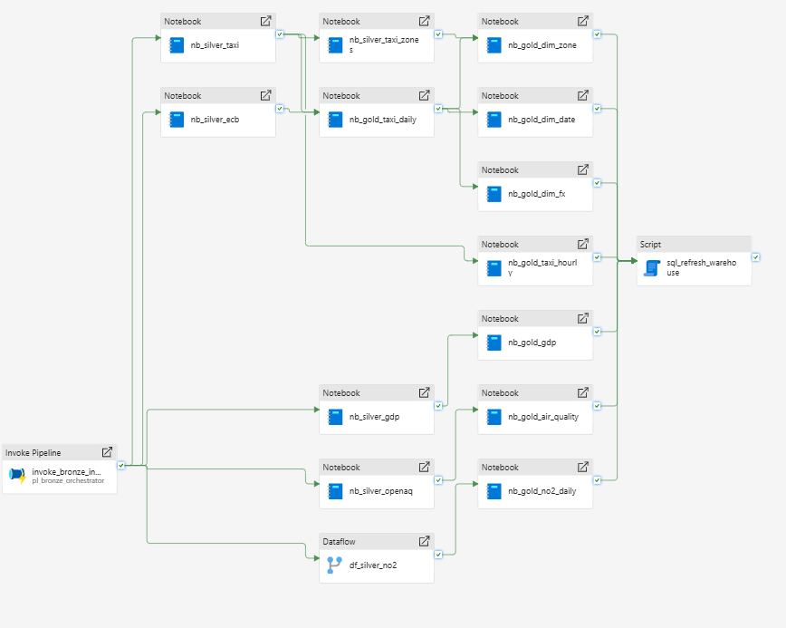
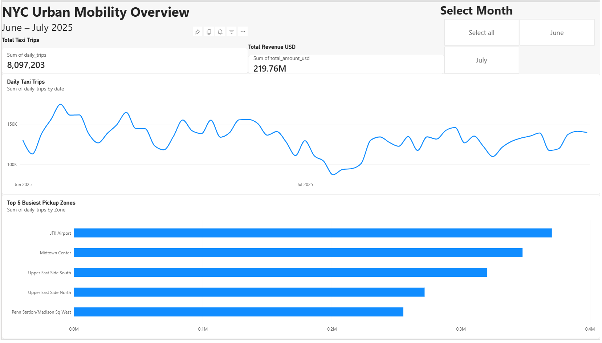
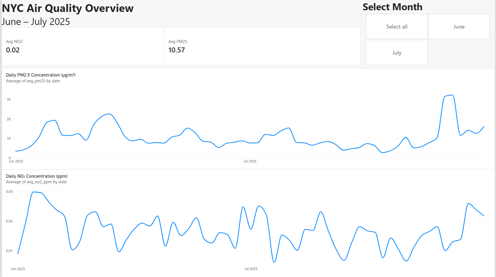
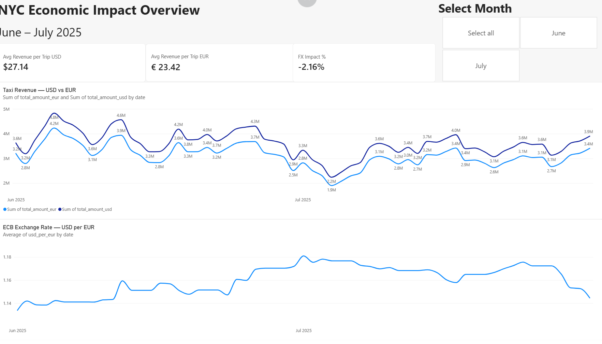
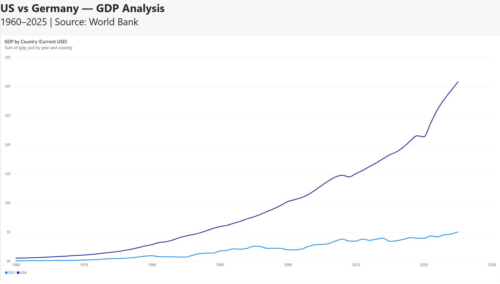

# Microsoft Fabric — Urban Analytics Platform

## Project Overview

An end-to-end Data Engineering platform developed as part of the Itransition Data Engineering internship.

The project integrates urban mobility, air quality, foreign exchange rates, and economic indicators into a unified analytical platform using Microsoft Fabric.

It demonstrates multi-source data ingestion, distributed data processing, Medallion Architecture, data warehousing, ETL orchestration, data quality validation, semantic modeling, and business intelligence.

## Technology Stack

| Category | Technologies |
|---|---|
| Cloud Platform | Microsoft Fabric, OneLake |
| Data Storage | Lakehouse, Data Warehouse, Delta Lake, Parquet |
| Programming | Python, PySpark, SQL, T-SQL |
| Data Integration | Data Factory Pipelines, Dataflow Gen2, REST APIs |
| Data Transformation | Apache Spark, Power Query M |
| Data Modeling | Star Schema, Fact and Dimension Tables |
| Business Intelligence | Power BI, DAX, TMDL |
| Version Control | Git, GitHub |
| Development Environment | VS Code, Ubuntu WSL2 |

## Architecture

The platform follows the Bronze, Silver, and Gold Medallion Architecture.

[View the complete architecture diagram](docs/architecture.md)

### Bronze Layer

- Raw data ingestion from external sources.
- Parameterized monthly taxi data ingestion.
- Historical source data preservation.
- API and file-based data integration.

### Silver Layer

- Data cleansing and standardization.
- Schema and data type transformations.
- Duplicate detection.
- Missing value handling.
- Reporting period validation.
- Data quality checks.

### Gold Layer

- Business-oriented aggregations.
- Daily and hourly mobility analytics.
- Air quality analytics.
- Currency conversion.
- Historical GDP analysis.
- Fact and dimension table preparation.

### Data Warehouse

The analytical Warehouse contains five dimension tables and five fact tables.

| Dimension Tables | Fact Tables |
|---|---|
| DimDate | FactTaxiDaily |
| DimZone | FactTaxiHourly |
| DimFX | FactAirQualityDaily |
| DimGDP | FactNO2Daily |
| DimEPAStation | FactEPANO2Hourly |

## Data Sources

| Source | Dataset |
|---|---|
| NYC TLC | Yellow Taxi Trip Records |
| NYC TLC | Taxi Zone Lookup |
| OpenAQ | PM2.5 and NO2 measurements |
| European Central Bank | EUR/USD exchange rates |
| World Bank | Historical GDP indicators |
| US EPA AQS | Hourly NO2 measurements |

The primary reporting period is June–July 2025.

## Pipeline Orchestration

The master pipeline `pl_urban_analytics_etl` coordinates the main ETL workflow:

1. Bronze ingestion orchestration.
2. Silver data transformations.
3. Gold analytical transformations.
4. Warehouse refresh.

The pipeline supports parameterized monthly taxi ingestion and repeatable historical data processing.

Selected OpenAQ and EPA ingestion workflows are maintained separately.

### Successful Pipeline Execution

## Data Quality and Idempotency

The following validation techniques were applied:

- Null value analysis.
- Duplicate detection.
- Reporting period validation.
- Fact table grain validation.
- Referential integrity checks.
- Source-to-target row count reconciliation.
- Revenue reconciliation.
- Repeated pipeline execution checks.

Key Warehouse metrics were compared across repeated executions to validate aggregate-level idempotency.

## Project Results

| Metric | Result |
|---|---:|
| Reporting period | June–July 2025 |
| Reporting days | 61 |
| Taxi trips analyzed | 8,097,203 |
| Daily taxi fact records | 14,932 |
| Total recorded amount in USD | $219,764,965.42 |
| Total converted amount in EUR | €189,630,019.62 |
| Warehouse tables | 10 |
| Semantic model tables | 8 |
| Semantic model relationships | 7 |
| Power BI report pages | 6 |

## Semantic Model

The Power BI semantic model includes fact and dimension tables, active relationships, and DAX measures for interactive analytical reporting.

Key analytical measures include:

- Total taxi trips.
- Total amounts in USD and EUR.
- Average revenue per trip.
- Foreign exchange impact.
- Average PM2.5 and NO2 concentrations.
- Pearson correlation between taxi activity and air pollution.

## Power BI Dashboards

### 1. Mobility Analytics

Analysis of taxi activity, geographic distribution, and financial metrics.

### 2. Air Quality Analytics

Analysis of daily PM2.5 and NO2 measurements.

### 3. Mobility vs Pollution

Analysis of the relationship between taxi activity and air pollution using dynamic correlation measures.

Correlation does not imply causation.

### 4. Economic Impact

Analysis of taxi revenue, currency conversion, and foreign exchange impact.

### 5. GDP Analysis

Long-term economic comparison between the United States and Germany using World Bank GDP indicators.

### 6. Hourly Mobility Analytics

Analysis of hourly taxi activity across four selected NYC taxi zones.

The hourly dataset represents selected zones rather than citywide taxi activity.

## Repository Structure

| Directory | Description |
|---|---|
| `notebooks/` | PySpark data processing notebooks |
| `pipelines/` | Microsoft Fabric pipeline definitions |
| `dataflows/` | Dataflow Gen2 Power Query templates |
| `sql/` | Warehouse SQL scripts and validation queries |
| `semantic_model/` | TMDL semantic model and DAX definitions |
| `screenshots/` | Power BI dashboards and pipeline execution |
| `docs/` | Architecture documentation |

## Deployment Overview

To reproduce the project in a Microsoft Fabric environment:

1. Create a Fabric workspace and configure capacity.
2. Create the Lakehouse and Data Warehouse.
3. Import and configure the notebooks, pipelines, and Dataflows.
4. Configure external data connections and API credentials.
5. Load the required historical source datasets.
6. Execute the Bronze, Silver, and Gold transformations.
7. Create and refresh the Warehouse tables.
8. Configure the semantic model and Power BI report.

Workspace references, connections, and data destinations must be adjusted for the target environment.

A complete deployment into a new workspace has not been validated.

## Security and Limitations

- API credentials must be configured separately.
- Notebook execution outputs were removed before publication.
- Selected EPA and OpenAQ ingestion definitions were excluded from the repository pending additional credential validation.
- Some historical API workflows require manual execution.
- EPA-specific Warehouse tables are not included in the current Power BI semantic model.
- Aggregate-level idempotency was validated, rather than full row-level equivalence.
- Full automated CI/CD deployment has not been implemented.

## Future Improvements

- Centralized secrets management.
- Fully automated API ingestion.
- Extended incremental loading.
- Automated data quality testing.
- Pipeline monitoring and alerting.
- CI/CD deployment across Fabric environments.
- Extended hourly mobility coverage.

## Author

**Abay Turar**

M.S. in Computer Information Systems — Data Management and Business Intelligence, Boston University.

Data Engineering | Python | SQL | PySpark | Microsoft Fabric

- GitHub: https://github.com/tabayb
- LinkedIn: https://www.linkedin.com/in/abay-turar-527766285/

Developed as part of the Itransition Data Engineering internship, 2026.
