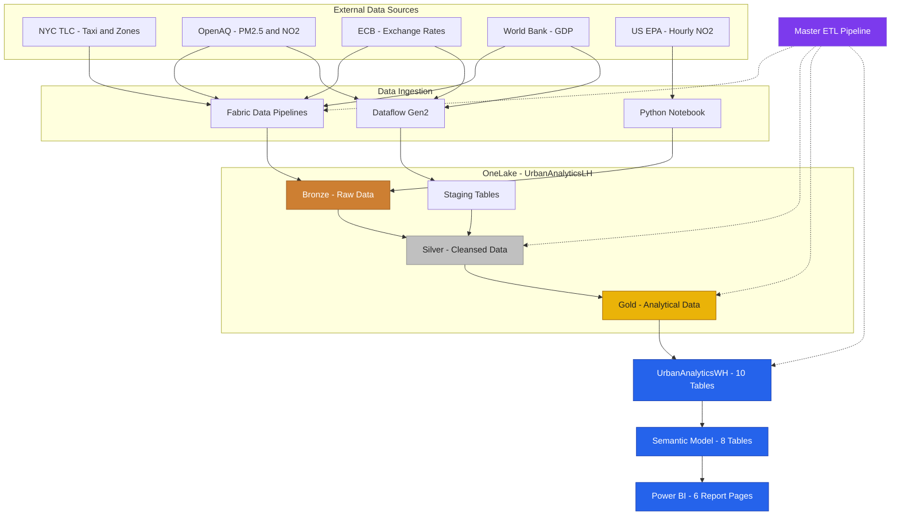

# Platform Architecture

## End-to-End Data Flow

## Architecture Notes

- Solid arrows represent data flow.
- Dashed arrows represent orchestration.
- PySpark notebooks implement Silver and Gold transformations.
- T-SQL scripts refresh the main Warehouse tables.
- Power BI consumes analytical data through the semantic model.
- Selected OpenAQ and EPA ingestion workflows are maintained separately from the automated master pipeline.
- EPA-specific Warehouse tables are not included in the current Power BI semantic model.
- API credentials must be configured separately.
